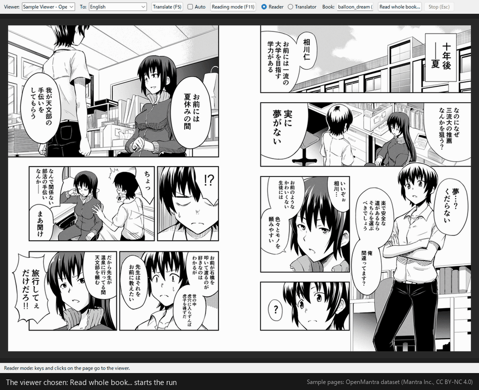

# TASlation

English: [README.md](README.md)

**自分の漫画を、自分のパソコンで訳しながら読むためのツール**

TASlation（Tool Assisting Self-translation）のウィンドウは、お使いのビューアに表示されている漫画のページを読み取り、
このパソコン上で翻訳して、訳文をページに重ねて表示します。外部には画像データや訳文を送りません。個人で買った文書を翻訳して読むという適法な行為を補助するためのツールです。

## 動いているところ

「一冊まるごと翻訳」の実際の画面です（画面は英語表示。読み取りは 1.2 倍速、翻訳は 1.5 倍速にしてあります）。代役ではなく、実際の OCR と翻訳モデルが動いています。

1. **めくりながら読み取る**：ビューアでページをめくると、TASlation がそのページを読み取ります。青い枠が、見つけたセリフです。下の一覧に、読んだページが並びます。
2. **「読み終えた」を押す**：最後までめくったら押します。ここからはビューアを使いません。
3. **訳が 1 行ずつ入っていく**：いま訳しているページが映り、モデルが答えた行から順に、吹き出しの日本語が訳に置き換わります。まだ訳していない行は、原文のまま枠で囲まれています。
4. **完了**：ビューアでそのページを開くと、訳が重ねて表示されます。

この録画では、見開き 4 画面（8 ページ）・85 行の翻訳に、GPU のあるパソコンで約 30 秒かかりました。

録画に映っているページは [OpenMantra データセット](https://github.com/mantra-inc/open-mantra-dataset)（Mantra Inc. 公開。Hinami, Ishiwatari, Yasuda, Matsui「Towards Fully Automated Manga Translation」AAAI 2021）のもので、[CC BY-NC 4.0](https://creativecommons.org/licenses/by-nc/4.0/) で提供されています。録画の中では、TASlation が日本語を消して英訳を載せています（改変あり）。この録画は TASlation 本体の MIT ライセンスの対象ではなく、配布用の ZIP にも入りません。

## なぜ作ったのか

TASlation は、漫画を正規に買い、きちんと読みたい人のためのツールです。ビューアが表示しているページの吹き出しから日本語を読み取り、
自分のパソコンで翻訳し、訳文で吹き出しを描き直して画面に表示します。アップロードも複製も共有もしません。
訳文は自分のパソコンにとどまり、ページを保存・書き出し・配布する機能はありません。

ビューアなしで本を読む手段にならないよう、意図して作っています。保存するのは訳文だけで、それもページごとの指紋（ページ指紋）に結び付けているため、
実物のページが画面になければ役に立ちません。

日本語版を扱うストアで買い、そのストアのビューアで開き、自分の言語で読む。出版社と作者には代金が入り、読者は日本人と同じものを、同じ価格で、同じタイミングで読むことができます。

## できること

* Windows 上で、ビューア（デスクトップのビューアでも、ブラウザで読むビューアでも、単なる画像ビューアでも）のウィンドウを取り込みます。
* 吹き出しと枠の文字を見つけ、3つの OCR モデルで日本語を読み取り（文字を1つずつ見つけるモデルと、行を読む2つのモデル）、ローカルAIモデルに翻訳させます。認識した日本語を消し、訳文を同じ吹き出しの形に沿って入る限り大きく組み、TASlation のウィンドウに表示します。
* **翻訳ツール**: 後からOCRの認識範囲を追加・調整できます。太字、斜体、フォントの設定が可能です。訳注の追加も可能です。名前や固有名詞辞書があり、ローカルAIに渡して高精度な翻訳をすることができます。
* **1冊まるごと翻訳する**（任意。既定は1ページずつ）: あなたがページをめくって読み進めるあいだに、めくられたページを読み取ります。「読み終えた」を押すと、話全体を踏まえてまとめて翻訳します。TASlation が自分でページをめくることはありません（これは読み放題などのサービスを提供するストアの規約を侵さないためです）。翻訳したページを読めるようになるのは翻訳が終わってからです。特に翻訳に時間がかかるCPUのみの環境に適しています。
* **読書モード**（F11）: 訳し終わったページを全画面で表示し、原書と同じ感覚で読めます。
* **全画面のビューアの上に**（任意）: ビューアをご自分で全画面にしたとき、TASlation はスクリーン キーボードのように手前に表示されたまま、キー入力をビューアから奪いません。ページはいつもどおりビューアでめくれます（「表示」メニューでオフにできます）。TASlation がビューアを全画面にしたり、あなたの押していないキーを送ったりすることはありません。
* **多言語対応**: 操作画面で17言語、翻訳先で20言語に対応しています（テストはできていません）。

## しないこと

| しないこと | 説明 |
|---|---|
| ネットワークへの送信 | 翻訳のために情報を外部に送信することはありません。全てローカルで完結します。 |
| ページ画像の保存 | 取り込んだページ、切り出した画像、訳したページはメモリ上にしかありません。「画像を保存」ボタンも書き出しコマンドもありません。1冊まるごと翻訳するときにメモリに置くページ画像は、作業中のページを進み具合として映すことと、ビューアで開いたページを早く表示することにだけ使います。 |
| 日本語原文の保存 | キャッシュに入るのは *訳文* と吹き出しの位置、320ビットのページ指紋です。日本語の本文はディスクに書きません。 |
| ビューアなしで読めるようにすること | キャッシュの内容は、ビューアに表示された実物のページの上に、指紋が一致したときだけ表示できます。1冊まるごと翻訳したときも同じで、メモリ上のページを TASlation の中でめくって読むことはできません。下のページ一覧のサムネイルをクリックしても、ビューアでそのページを開くよう案内するだけです。ビューア無しで読むのは、視聴に応じた対価がある場合などで問題になるため行いません。 |
| ビューアのキャプチャ保護を破ること | 使うのは Windows の通常のウィンドウ取り込み機能だけです。ビューアが取り込み不可にしたウィンドウは黒く写り、TASlation はそのままにします。何も復号せず、DRM・ファイル形式・通信プロトコルには一切触れません。 |
| 共有 | アカウントも同期もアップロードもなく、読める形のものは何も書き出しません。自分の訳文のキャッシュは、自分用の控えや自分の別のパソコン（もしくは将来作成するかもしれないスマートフォン版のリーダー）のために、自分のパスフレーズで暗号化したファイルにできますがパスフレーズがなければ読めません。これは決して共有しないで下さい。 |

## 法的な位置づけ

TASlation は、手元にある本を自分の画面で読むためのツールです。この節では、法律の上で何をしているのか、それがどこで許されるのか、
なぜ一部の機能を意図して入れていないのか、起動時の注意事項が何のためにあるのかを説明します。作者が理解している範囲の説明であって、
法的助言ではありません。法律は国によって異なり、また変わります。

### 法的に見て何をしているか

ページをめくるたびに、TASlation はビューアが画面に描いたものの一時的な複製（メモリ上の取り込み）を作り、
自分のパソコン上のモデルで文字を翻訳し（著作物の翻案）、その結果を同じページの上に、あなた一人に表示します。読んだページを二度訳さないよう、
キャッシュに訳文と吹き出しの位置、ページ指紋を保存します。それ以外は何も残さず、何もパソコンの外に出しません。

取り込みは一時的なものです。日本では、第2条が有形の複製を求めるため、そもそも複製にあたらないとも考えられ、
いずれにしても第47条の4が認める電子計算機の処理に付随する複製の範囲内です。EU と英国では、
一時的な複製についての強行的な例外規定が対象とする一時的な複製です。したがって法律が受け入れる必要があるのは、取り込みではなく翻訳という行為です。

### どこで許されるか

適用されるのは、本やストアや出版社の国にかかわらず、あなたが読んでいる場所の法律です。著作権は属地的なもので、日本の出版社が外国の読者を訴えるとしたら、
その国の法律で訴えることになります。自分用の翻訳を侵害とみなす国でも、それは民事上の問題です。理屈の上では著作者が訴えることはできても犯罪ではなく、共有していない私的な翻訳で訴えられた例はこれまでありません。
そもそも私的な翻訳を検知できる手段は存在しません。

訳文を共有するのは別の話で、実際に法律が執行されているのはこちらです。訳文だけで問題になりえます。
2016年7月、京都府警は、映画『ポルターガイスト』の英語字幕を日本語に訳し、
その字幕ファイルを字幕サイトで公開したとして、東京の男性を著作権法違反の疑いで逮捕しました。男性が配布したのは映像ではなく、訳した台詞だけでした。
2017年4月、アムステルダム地方裁判所は、ファン字幕グループ自身が著作権保護団体 BREIN を相手に起こした訴訟で、
字幕の作成と配布には権利者の許可が必要だと判断しました。2017年9月には、スウェーデンの裁判所が字幕サイト
Undertexter.se の創設者に著作権侵害で有罪判決を出し、2018年に控訴も退けられました。

漫画の訳文を誰かに渡すのも同じ行為です。日本では翻訳権と公衆送信権の侵害にあたり、権利者の告訴により起訴される犯罪で、
著作権法第119条に違反します。だから TASlation は、訳文をあなたの画面と、あなたにしか読めないキャッシュの中にとどめます。

ここまでは法律の話です。
ここからは各電子書籍ストアとの話になります。

* **ストアの利用規約**: 大手の電子書籍ストアの利用規約は、読者とストアとの間の契約です。そのいくつかは、私的な使用であっても
  コンテンツの複製や翻訳を禁じ、あるいは利用をストア自身のソフトウェアを通じたものに限っています。規約に違反しても犯罪ではありませんが、
  アカウントを停止され、購入した本のライブラリを失うことがあり得ます。
* **ページをめくるのはあなたです**: TASlation はページを自分でめくりません。1冊まるごと翻訳するときも、読み取るのはあなたがめくったページだけで、
  日本の読者と同じように、ご自分で読み進めることが前提です。ただし、それでストアの規約上問題がないと決まるわけではありません。
  規約はストアごとに異なるので、ご自分で確認してください。
  
これは著作権法とは別の問題で、著作権法のもとでは、私的な複製と翻訳は認められています（日本では下記の第30条と第47条の6）。

### 内容に関する法律: 本は出版されたまま表示されます

日本で販売される漫画は日本の法律のもとで出版されており、TASlation はそれを検閲もフィルタリングもせず、そのまま表示します。
日本で合法に販売できるものでも、ほかの国では、絵であっても、私的に読むだけであっても、所持・輸入・閲覧が違法になることがあり、
単純所持が重い犯罪になる国もいくつかあります。典型は、未成年に見えるキャラクターの性的な絵です（実在の児童の性的な画像は、日本を含むどの国でも犯罪です。国による違いは絵の扱いにあります）。

* 英国の Coroners and Justice Act 2009（第62条）は「児童の禁止画像」の所持を犯罪とし、
  この条文はまさに写真以外の画像を対象にするために設けられています。
* カナダの刑法（第163.1条）はあらゆる視覚的表現を対象とし、最高裁は R. v. Sharpe で「人」には架空の人物も含まれると判断しました。
  2010年には、ノートパソコンの漫画をめぐってカナダの国境で旅行者が起訴され、起訴が取り下げられたのは2年後でした。
* オーストラリアでは、McEwen v Simmons（ニューサウスウェールズ州最高裁、2008年）が、
  児童虐待物の罪について漫画のキャラクターも「人」になり得ると判断しました。
* 米国では、18 U.S.C. § 1466A が未成年者のわいせつな絵の所持を連邦犯罪としています。2009年には収集家が有罪を認め、
  日本の単行本数十冊が没収されました。
* 韓国の青少年保護の法律は、アニメや漫画を含め、未成年と認識できる表現に及び、所持と閲覧を罰します。
* ドイツの刑法第184b条は「現実に近い」出来事の描写に及ぶため、明らかに架空の絵は一般に対象外ですが、現実に近いものは対象になります。

国境の係官が、旅行者の持つ機器を調べることもあります。TASlation は複製を残しませんが、自分が持つ電子書籍や自分で保存したものは自分の責任です。
読む場所でその本が合法か確信が持てないなら、TASlation で読まないでください。そもそも読まないでください。

### 国別の概要

起動時の注意事項の後半は、選んだ国に合わせて、ウィンドウの言語で書かれています。以下はその内容を国ごとに1行にまとめたものです。「民事」とは、
法律上は侵害にあたるが、共有しない私的な使用には刑事罰がない、という意味です。いずれも法的助言ではありません。

| 国 | 自分のための複製と翻訳 | 絵による表現と所持 |
|---|---|---|
| 日本 | 認められる: 著作権法第30条・第47条の6 | わいせつ物の罪は頒布・販売の罪で、私的な所持は対象外。児童ポルノ禁止法は実在の児童だけが対象で、絵は対象外 |
| 英国 | 2015年以降、私的複製の例外なし。自分用の翻訳は侵害（民事） | 児童の禁止画像（Coroners and Justice Act 2009 第62条）は絵を含む。最長3年 |
| 米国 | 私的使用の例外なし。フェアユースは未判断。DMCA 第1201条のもとでの画面の取り込みは未決着 | 18 U.S.C. § 1466A: 未成年者のわいせつな絵。2009年に漫画の収集家が有罪を認めた |
| カナダ | 第29.22条は複製のみで、翻訳は対象外（民事） | 第163.1条は架空の人物を含む（R. v. Sharpe）。2010年に国境で漫画をめぐり旅行者が起訴された |
| オーストラリア | 第43C条は本の形式変換のみ。翻訳は対象外（民事） | 漫画のキャラクターも「人」（McEwen v Simmons）。分類を拒否された作品は輸入できない |
| ニュージーランド | 一般的な私的使用の例外なし（民事） | 有害出版物には漫画も含まれる。知りながらの所持は最長10年 |
| アイルランド | 研究または私的学習のためのフェアディーリングのみ（民事） | 1998年法は、児童という印象が支配的な描かれた人物を含む。最長5年 |
| ドイツ | 第53条の私的複製。第23条により翻案は公表するまで自由 | 第184b条は現実に近い（"wirklichkeitsnah"）描写が対象。明らかに架空の絵は一般に対象外 |
| オーストリア | 第42条の私的複製。翻案の利用には同意が必要だが、作成には不要 | 第207a条は現実に近い描写が対象 |
| スイス | 著作権法第19条: 私的領域でのあらゆる使用、翻訳を含む | 刑法第197条: 未成年者との架空の性行為はハードポルノ。自分用の所持も処罰対象 |
| フランス | L122-5条の私的複製。L122-4条は同意のない翻訳をすべて違法とする（民事） | 227-23条は絵を含む「表現」が対象。2013年に未成年に見える者にも拡大 |
| ベルギー | 家族の範囲内での私的複製。翻訳は未決着 | 第417/13条は未成年者または未成年に見える者が対象で、実在か擬似かを問わない。警察は漫画も該当し得るとしている |
| オランダ | 第16b条の私的複製。翻訳は複製とみなされる（第13条） | 仮想の素材は現実に近い場合のみ。実在の児童と見分けがつかない場合を除き、絵は対象外 |
| スペイン | 第31.2条の私的複製。翻訳（変形）は例外の対象外（民事） | 第189条「現実に近い画像」。検察通達2/2015はカートゥーンと漫画を除外 |
| メキシコ | 第148条IVの私的複製1部。翻訳は対象外（民事） | 第202条は実在の人物を前提に書かれている |
| アルゼンチン | 私的複製の例外は一切なし（民事） | 第128条（2018年）は「表現」の単純所持を罰する。絵については争いがある |
| ブラジル | 第46条IIは小さな抜粋のみ（民事） | ECA 第241-B条・第241-C条。「その他あらゆる形態の視覚的表現」は絵を含むと解釈されている |
| ポルトガル | 第75条第2項a号の私的複製。翻訳は対象外（民事） | 第176条「現実に近い表現」。様式化された絵は一般に対象外 |
| イタリア | 第71-sexies条は録音・録画物のみ。翻訳は対象外（民事） | 第600-quater.1条の仮想画像。2025年に破毀院が範囲を拡大。コミックの収集家が訴追された |
| ポーランド | 第23条の個人的使用。範囲は広い | 第202条§4bは生成・加工された未成年者の画像。絵については議論がある |
| ロシア | 第1273条の個人的複製。翻訳は対象外（民事） | 第242.1条は頒布目的が要件。絵は未決着 |
| トルコ | FSEK 第38条の個人的複製。翻訳は対象外（民事） | TCK 第226条第3項は描かれた描写やアニメの描写に及ぶと解釈されている。2年から5年 |
| インドネシア | 第46条の個人的複製1部。翻訳は対象外（民事） | ポルノ法はカートゥーンを含む。自分用の所持は解説で除外。頒布は犯罪 |
| ベトナム | 第25条の個人的な研究・学習のための複製1部。翻訳は対象外（民事） | 第326条は流布目的が要件。保管には行政罰 |
| 中国 | 第24条第1項の個人的な学習・研究・鑑賞。翻訳を含む | 刑法第363条〜第367条は販売と流布を罰する。所持だけでは犯罪にならない |
| 台湾 | 第51条の個人または家庭での非営利の使用。第63条でそのための翻訳 | 児童及び少年性搾取防止条例。絵については議論がある |
| 香港 | 私的複製の例外なし。翻訳は翻案（民事） | Cap. 579 は16歳未満として描かれた人物の描写が対象で、絵を含む。芸術的価値による抗弁あり |
| シンガポール | 2021年著作権法: フェアユースのみ | 刑法第377BK条の児童虐待物は描かれた描写を含む。最長5年。わいせつな出版物や映画も犯罪 |
| フィリピン | 第187条の研究または私的学習のための複製1部（民事） | RA 11930: 「児童」には手で描かれた画像を含む。所持は犯罪 |
| 韓国 | 第30条の私的複製。第36条でそのための翻訳 | 青少年保護の法律は、アニメや漫画を含め、未成年と明らかに認識できる表現が対象。所持と閲覧は犯罪 |

### 起動時の注意事項

こうした事情から、ウィンドウは起動時に注意事項を表示します。まず、どの国にいるか（Windows の地域設定から候補を出します）と、
ウィンドウの言語（国から候補を出します）を尋ね、その言語で全般的な注意を表示します。内容は、TASlation が何をするか、
私的使用は日本では認められているがどこでもそうではないこと、訳文は決して共有してはならないこと、本は出版されたまま表示され、
読む場所によっては所持が違法になり得ること、訳文は誤り得ることです。さらに「民事上の問題」の意味、適用されるのは読む場所の法律であること、
現実の危険の大きい順（特定の内容の所持に関する法律、規約違反によるストアのアカウント停止、そして訳文を共有した場合にだけ問題になる著作権）も説明します。

選んだ国の部分（上の表の内容）は、最初の段落のすぐ後に国名の見出しを付けて表示します。あなたにとって決め手になるのはこの部分だからです。
一覧にない国には一般的な警告を表示します。

注意事項は「次回以降表示しない」にチェックを入れるまで、起動のたびに表示します。

### 免責事項と商標

TASlation のコードは MIT ライセンスのフリーソフトウェアで、現状のまま、いかなる保証もなく提供されます。ただし、ページを読むのに必要な3つの OCR モデル（manga-ocr-charspot-small、manga-ocr-nar-small、manga-ocr-base-CPT-flex）の重みは CC BY-NC-SA 4.0 なので、**TASlation の利用は非営利に限られます**。法令が許す限りにおいて、作者は、
本ソフトウェアの使用、本ソフトウェアで読んだ本、このページと注意事項の情報（変わり得る法律の要約であり、法的助言ではありません）から生じるいかなる損害や法的な結果についても責任を負いません。使うかどうかは、あなたが自分のいる場所で決めることです。
起動時の注意事項もそう述べ、ウィンドウを開く前に同意を求めます。

TASlation は、どの電子書籍ストア、ビューア、出版社とも提携しておらず、承認も受けておらず、関係もありません。

### 出典

各国の法律と判例の出典は [docs/LEGAL_SOURCES.md](docs/LEGAL_SOURCES.md) にあります。

## 動作環境

* Windows 10/11（64 ビット）
* 空きディスク約 7.5 GB（ポルトガル語（ブラジル）とトルコ語に翻訳する場合は約 9.0 GB。翻訳モデルは PLaMo 3 Translate 2B が約 1.8 GB（取り込むあいだだけ約 3.8 GB）、ポルトガル語（ブラジル）とトルコ語に使う Qwen3.5 4B が約 3.3 GB で、入れるのは翻訳先に要るどちらか一方です）。
  NVIDIA の GPU があるパソコンでは、PyTorch の GPU 版の分がさらに約 3.7 GB（インストールのあいだだけ、もう約 2.6 GB）要ります
* RAM 16 GB 推奨（最低 8 GB）
* NVIDIA GPU（メモリ 6 GB 以上）推奨。無くても動きますが、翻訳が遅くなります。AMD と Intel の GPU は使いません（CPU で動きます）。
* 本を表示するビューア（アプリやブラウザ）

| 処理 | GPU あり | GPU なし |
|---|---|---|
| 1ページ | 約5秒 | 約35〜50秒 |
| 1冊（190ページ）をまるごと読む | 約45〜60分 | 約2〜3時間 |

## インストール

1. GitHub の「Code」→「Download ZIP」でダウンロードし、ZIP を**すべて展開**します。インストール後はフォルダーを移動しないでください。
2. `install.cmd` をダブルクリックします。警告が出たら「詳細情報」→「実行」で続けてください。
3. 最初に翻訳先の言語を尋ねます（番号か英語の名前。Enter で表示された言語）。この言語で翻訳モデルが決まります。
   次に、3つの OCR モデル（合わせて約 700 MB）の利用条件（非営利のみ、CC BY-NC-SA 4.0）への同意を1回だけ尋ねます。TASlation はこれらのモデルなしではページを読めないので、
   同意しないときはインストールしません。翻訳先がポルトガル語（ブラジル）とトルコ語以外なら、翻訳モデル PLaMo 3 Translate 2B（約 1.8 GB）のライセンス（PLaMo Community License）への同意も尋ねます（この2つの言語は Qwen3.5 4B、約 3.3 GB で、ライセンスへの同意は要りません）。残りの質問は Enter で答えれば、このパソコンに必要なものがそろいます。
   Python と Ollama を入れるかどうかの質問に Y と答えると、それをインストールする winget（Windows のパッケージ管理ツール）が示す利用条件にも同意したことになります（途中で winget に尋ねられないように）。
   絵の上の文字を見つけて消す2つのモデル（レイアウトモデル約 170 MB、画像補完モデル LaMa 約 200 MB）を入れるかどうかも尋ねます。
   どちらも学習画像の出どころを明らかにしていないので、そのことを示してから尋ねます。NVIDIA の GPU があるパソコンでは Enter で入れ（[Y/n]。TASlation は GPU で LaMa を既定で使います）、
   GPU のないパソコンでは Enter で入れません（[y/N]。そのパソコンでは既定で使わないモデルです）。コンソールのない実行と `-Yes` では、どちらのパソコンでも入れません。
   質問は、Windows の表示言語が日本語なら日本語で、それ以外は英語で表示します。
4. スタートメニューの「TASlation」から起動します。

PyTorch（TASlation が OCR と LaMa に使う部品）は、NVIDIA の GPU があるパソコンには GPU 版（CUDA 版。ダウンロード約 2.6 GB、RTX 50 シリーズなど最新の GPU では約 2.0 GB）、
ないパソコンには CPU 版（約 0.13 GB）を入れます。GPU があるかどうかは、NVIDIA のドライバーに付いている `nvidia-smi` に尋ねるだけで（ネットワークは使いません）、質問はしません。
ダウンロードの大きさは、質問のあいだ、ダウンロードを始める前に表示します。GPU 版には NVIDIA のドライバー 528.33 以降（RTX 50 シリーズなどは 580 以降）が要り、
それより古いドライバーではそう表示して CPU 版を入れます（ドライバーを更新して install.cmd を実行し直せば GPU 版になります）。GPU 版はインストールのあと GPU で一度計算して確かめ、
ダウンロードできなかったときや GPU で動かなかったときは、1行でそう伝えて CPU 版を入れ、インストールを続けます。AMD と Intel の GPU は GPU として数えません。
すでに入っている GPU 版はそのまま残します。この版より前に CPU 版を入れたパソコンでは、install.cmd を実行し直すと GPU 版に置き換えます（`update.cmd` では置き換えません）。

ネットワークを使うのはインストールのときだけです。Python、Ollama、翻訳モデルは、無ければ同意を得てダウンロードします。
その後の TASlation は、このコンピューターの外には接続しません。

質問は最初にまとめて行います。答えたあとは席を離れてかまいません。回線にもよりますが、15〜60 分ほどかかります。
ダウンロードの進み具合はパーセントと MB で表示します。接続が途中で切れても、切れたところから続けます。

### 更新

1. 新しい ZIP をダウンロードし（GitHub の「Code」→「Download ZIP」）、TASlation を閉じます。
2. TASlation のフォルダーにある `update.cmd` をダブルクリックします。
3. 新しい ZIP の場所を尋ねられたら、ZIP ファイル（または展開したフォルダー）をウィンドウにドラッグして Enter を押します。
   「ダウンロード」フォルダーにある、いちばん新しい `taslation*.zip` なら、Enter だけで選べます。
4. 今のバージョンと新しいバージョン（日付つき）を表示して、1回だけ確認します。そのあと新しいファイルをコピーし、`install.cmd` と同じインストールを続けます
   （新しい版に要るものがあれば、ダウンロードの前に尋ねます）。

更新のあとのインストールでは、入っている PyTorch をそのまま使います。NVIDIA の GPU があるのに CPU 版が入っているときは（この版より前に入れた場合）、
約 2.6 GB のダウンロードを尋ねずに始めることはせず、そう表示します。GPU 版にするには `install.cmd` を実行してください。

`taslation.toml`、`.venv`、`models`、データフォルダー（`~/.taslation`）はそのまま残ります。プログラムのフォルダー `taslation\` は新しい版と同じ中身になり
（新しい版にないファイルは消えます）、それ以外のファイルは消しません。`update.cmd` 自体はネットワークを使わず、渡された ZIP かフォルダーだけを読みます。
今のバージョンと日付は、ヘルプ →「TASlation について」でも確かめられます。

手でコピーする場合は、TASlation を閉じてから、ZIP の中の `taslation-main` フォルダーの**中身**を `install.cmd` があるフォルダーへコピーし
（フォルダーごとコピーしないでください。確認が出たら「置き換える」）、`install.cmd` を実行します。

### アンインストール

`uninstall.cmd` をダブルクリックすると、消えるものの一覧を表示して確認します（既定は「いいえ」）。翻訳キャッシュなどのデータを消すかどうかも、その場で尋ねます（既定は残す）。最後にフォルダーを削除してください。

## 使い方

1. 本をビューアで開きます。
2. スタートメニューの「TASlation」から起動し、「ビューア」欄でビューアのウィンドウを選びます（一度選べば、次からは自動で選ばれます）。
3. TASlation のウィンドウでページ送りのキーを押すか、ページをクリックしてめくると、訳されたページが表示されます（大きく読むには読書モード、F11）。

操作の説明は、アプリの「ヘルプ > 使い方」にあります。写植の大きさ（80〜130 %、本ごとにも決められます）やウィンドウの文字の大きさなど、よく変える設定と、ウィンドウのキー（ショートカット）は「ツール > 設定...」で変えられます。各処理が GPU と CPU のどちらで動き、1ページに何秒かかったかは、同じ画面の「システム」ページと `taslation doctor` で確かめられます。
設定やコマンドラインなどの詳しい説明は [docs/MANUAL.ja.md](docs/MANUAL.ja.md) にあります。

## 制限事項

* Windows 専用です（今の所は）。
* 読み取りと翻訳は自動なので、誤りがあります。手描きの効果音は描かれたまま残します。
* 単ページ表示と見開き表示を切り替えると、同じページでも別のページとして扱います。

詳しくは [docs/MANUAL.ja.md](docs/MANUAL.ja.md) にあります。

## サードパーティの表示

使用したプロジェクトや参考にしたプロジェクトとそのライセンスは、すべて `docs/THIRD_PARTY.md` にあります。
TASlation のコードは MIT ライセンスです（`LICENSE` を参照）。3つの OCR モデルの重みは CC BY-NC-SA 4.0 で、インストール時に各自が同意して取得します（`docs/THIRD_PARTY.md` を参照）。

Built with PLaMo: 翻訳には Preferred Networks の PLaMo 3 Translate 2B（PLaMo Community License）を使います。ポルトガル語（ブラジル）とトルコ語は Qwen3.5 4B（Apache-2.0）です。
