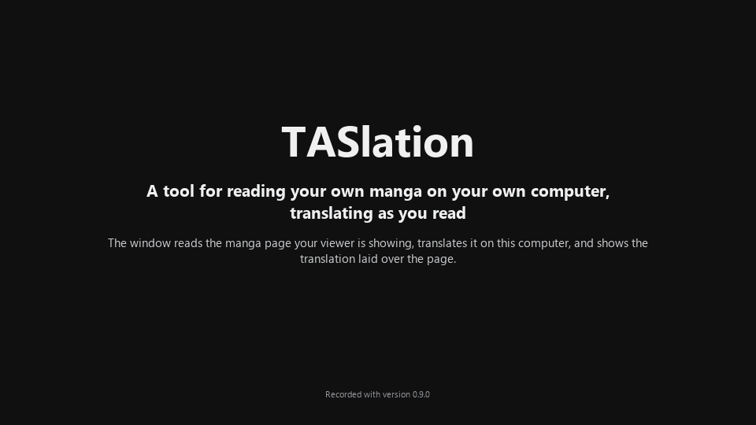

# TASlation

English: [README.md](README.md)

**自分の漫画を、自分のパソコンで訳しながら読むためのツール**

TASlation（Tool Assisting Self-translation）のウィンドウは、お使いのビューアに表示されている漫画のページを読み取り、このパソコン上で翻訳して、訳文をページに重ねて表示します。日本では、著作権法が私的使用のための複製（第30条）と、その目的での翻訳（第47条の6）を認めています。ほかの国については、[docs/LEGAL.ja.md](docs/LEGAL.ja.md) に30か国の扱いをまとめています。

録画に映っているページは [OpenMantra データセット](https://github.com/mantra-inc/open-mantra-dataset)（Mantra Inc. 公開。Hinami, Ishiwatari, Yasuda, Matsui「Towards Fully Automated Manga Translation」AAAI 2021）に収録されている『バルーンドリーム』（朽鷹みつき 作）のもので、データセットは [CC BY-NC 4.0](https://creativecommons.org/licenses/by-nc/4.0/)（表示・非営利）で提供されています（録画では改変あり）。

## 特徴

* **オンザフライ翻訳**：ページをめくると、読む順に（右上の吹き出しから）その場で訳文に置き換わっていきます。推奨環境では、めくってから最初の吹き出しまで 1〜2 秒かかり、その後はおおむね読む速さより速く訳が進みます。
* **多言語対応**：翻訳先は 20 言語です（英語、スペイン語、ポルトガル語（ブラジル）、フランス語、ドイツ語、イタリア語、ロシア語、ポーランド語、オランダ語、トルコ語、インドネシア語、ベトナム語、タイ語、中国語（簡体字）、中国語（繁体字）、韓国語、アラビア語、ヘブライ語、ヒンディー語、ベンガル語）。操作画面は 17 言語です。
* **高精度翻訳**：文字は 3 つの OCR モデルで読み、読みが食い違ったときは、ほかの 2 つにいちばん近い読みを採ります。文字消しは 2 つの方式を使い分けます（白い吹き出しは紙の色で塗り、絵の上の文字は画像補完モデル LaMa で絵を補います）。翻訳には翻訳専用モデル PLaMo 3 Translate 2B を使い、前のページの文脈と、名前や用語の辞書を渡します。
* **ビューアを選ばない**：ビューアのウィンドウを画面キャプチャし、その画像に訳文を重ねて表示します。TASlation で押したページ送りのキーは、ビューアに渡します。スクリーンショットが撮れるビューア全てに対応します。
* **完全ローカル**：読み取りも翻訳もこのパソコンの中で行い、ページも訳文も外部に送りません。AI の追加学習も行いません。
* **完全無料**：作者が本プログラムによって利益を得ることはありません。無料で、広告も、寄付の受け付けも、有料版もありません。
* **高度な翻訳編集機能**：認識領域の追加・移動・大きさの変更・回転、訳文の書き換え、フォント・太字・斜体の指定、名前や用語の辞書（シリーズシート）、検索と置換ができます。ページとこの本の訳文への変更は、Ctrl+Z で元に戻せます。
* **低スペックでも動作**：メモリ 6 GB の NVIDIA GPU で動きます。GPU がなくても動きますが、翻訳にかかる時間は約 4 倍になります。

## しないこと

TASlation は、法律と権利者を尊重して開発しています。そのため、次の機能はありません。

* ページ画像の保存
* ビューアの自動操作
* キャプチャ保護の解除
* ネットワークでの共有

## インストール

1. [ZIP をダウンロード](https://github.com/tamachi955/taslation/archive/refs/heads/main.zip)して、すべて展開します。
2. `install.cmd` をダブルクリックします。
3. スタートメニューの「TASlation」から起動します。

質問（翻訳先の言語、モデルのライセンスへの同意など）は最初にまとめて尋ねます。そのあとは 15〜60 分ほどで終わります。

### 更新

新しい ZIP をダウンロードし、TASlation を閉じてから `update.cmd` をダブルクリックします。

### アンインストール

`uninstall.cmd` をダブルクリックし、終わったらフォルダーを削除します。

## 動作環境

| 項目 | 必要なもの |
|---|---|
| OS | Windows 10 / 11（64 ビット） |
| GPU | NVIDIA の GPU（メモリ 6 GB）を推奨。なくても動きます |
| RAM | 16 GB を推奨 |
| 空きディスク | 約 7.5 GB（翻訳モデル約 1.8 GB を含む）。NVIDIA の GPU があるパソコンでは、さらに約 3.7 GB |
| ネットワーク | インストールのときだけ使います |
| ビューア | 本を表示するアプリかブラウザ |

ポルトガル語（ブラジル）とトルコ語に翻訳する場合は、別の翻訳モデル（約 3.3 GB）を使うので、空きディスクは約 9.0 GB 要ります。

| 処理 | GPU あり | GPU なし |
|---|---|---|
| 1 画面に 1 ページ（約 10 行） | 約 6 秒 | 約 23 秒 |
| 1 画面に見開き 2 ページ（約 16 行） | 約 9 秒 | 約 30 秒 |
| 1 冊（190 ページ）をまるごと翻訳 | 約 15〜20 分 | 約 35 分〜1 時間 |

Intel Core i7-9700F、RAM 48 GB、GeForce GTX 1660 Ti（6 GB）での計測です。

## ドキュメント

* [手引き](docs/MANUAL.ja.md)：使い方、設定、制限事項
* [インストールと動作環境の詳細](docs/INSTALL.ja.md)
* [法的な位置づけ](docs/LEGAL.ja.md)：法律の上で何をしているか、国別の概要、意図して入れていない機能
* [変更履歴](CHANGELOG.md)

## ライセンス

TASlation のコードは MIT ライセンスです（`LICENSE`）。使用したプロジェクトとモデル、そのライセンスは [docs/THIRD_PARTY.md](docs/THIRD_PARTY.md) にあります。3 つの OCR モデルの重みは CC BY-NC-SA 4.0 で、インストールのときに各自が同意して取得します。

Built with PLaMo: 翻訳には Preferred Networks の PLaMo 3 Translate 2B（PLaMo Community License、2026年11月9日改定）を使います。ポルトガル語（ブラジル）とトルコ語は Qwen3.5 4B（Apache-2.0）です。
