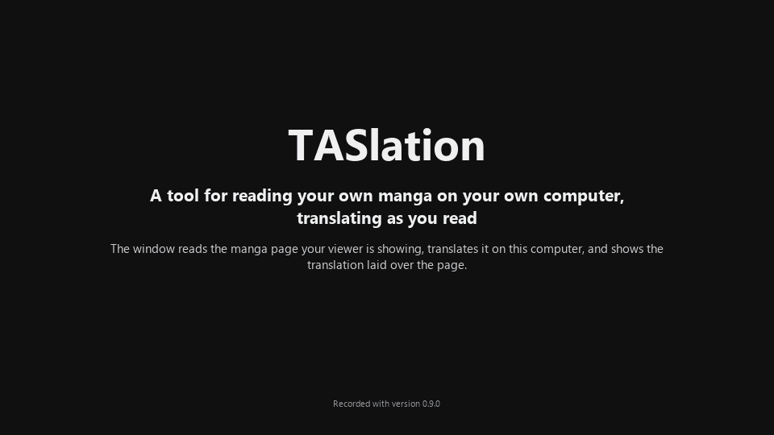

# TASlation

日本語: [README.ja.md](README.ja.md)

This is a translation. The Japanese text, [README.ja.md](README.ja.md), is the original, and it prevails where the two differ.

**A tool for reading your own manga on your own computer, translating as you read**

The TASlation (Tool Assisting Self-translation) window reads the manga page your viewer is showing, translates it on this computer, and shows the translation laid over the page. It is a tool that assists a lawful act: translating, to read it, a document you bought for yourself.

The pages in the recording are from the [OpenMantra dataset](https://github.com/mantra-inc/open-mantra-dataset) (published by Mantra Inc.; Hinami, Ishiwatari, Yasuda, Matsui, "Towards Fully Automated Manga Translation", AAAI 2021): the title バルーンドリーム by Mitsuki Kuchitaka (朽鷹みつき). The dataset is provided under [CC BY-NC 4.0](https://creativecommons.org/licenses/by-nc/4.0/) (attribution, non-commercial); the pages in the recording are changed.

## Features

* **On-the-fly translation**: when you turn a page, its bubbles are replaced by their translations there and then, in reading order (from the top right). On the recommended computer the first bubble takes 1 to 2 seconds after the turn, and from there the translation generally moves faster than you read.
* **Many languages**: 20 languages to translate into (English, Spanish, Portuguese (Brazil), French, German, Italian, Russian, Polish, Dutch, Turkish, Indonesian, Vietnamese, Thai, Chinese (Simplified), Chinese (Traditional), Korean, Arabic, Hebrew, Hindi, Bengali), and 17 languages for the window itself.
* **Accurate translation**: the text is read by three OCR models, and where their readings differ, the one closest to the other two is taken. Lettering is erased in two ways (a white bubble is filled with the colour of its paper; under lettering on the drawing, the inpainting model LaMa fills the drawing in). The translation is made by PLaMo 3 Translate 2B, a model built for translation, which is given the pages before as context and your list of names and terms.
* **Any viewer**: TASlation captures the viewer's window as the screen shows it and lays the translation over that picture. A page key you press in TASlation is passed on to the viewer. It touches neither the book's file nor the store's connection, so it works with a desktop viewer and with a viewer in a browser alike (not with a viewer that forbids screen capture).
* **Fully local**: the reading and the translating happen on this computer, and no page and no translation is sent outside. No model is trained further.
* **Free**: the author makes no profit from this program. It is free, with no advertising, no donations and no paid version.
* **Tools for editing a translation**: add, move, resize and turn the regions that are read; rewrite a translation; choose its font, bold and italic; keep a list of names and terms (the series sheet); find and replace. Ctrl+Z takes any change back.
* **Runs on a modest computer**: an NVIDIA GPU with 6 GB of memory is enough. It runs without a GPU too, and translating then takes about 4 times as long.

## What it does not do

TASlation is developed with respect for the law and for the rights holders. For that reason it has none of these:

* saving page images
* operating the viewer by itself
* getting round capture protection
* sharing over a network

## Installation

1. [Download the ZIP](https://github.com/tamachi955/taslation/archive/refs/heads/main.zip) and extract all of it.
2. Double-click `install.cmd`.
3. Start it from "TASlation" in the Start menu.

The questions (the language to translate into, agreeing to the models' licences and so on) are all asked at the beginning. After that it takes about 15 to 60 minutes.

### Updating

Download the new ZIP, close TASlation, and double-click `update.cmd`.

### Uninstalling

Double-click `uninstall.cmd`, and delete the folder when it has finished.

## Requirements

| Item | What is needed |
|---|---|
| OS | Windows 10 / 11 (64-bit) |
| GPU | An NVIDIA GPU (6 GB of memory) recommended. It runs without one |
| RAM | 16 GB recommended |
| Free disk space | About 7.5 GB (the translation model, about 1.8 GB, included). On a computer with an NVIDIA GPU, about 3.7 GB more |
| Network | Used only while installing |
| Viewer | An app or a browser that shows the book |

Translating into Portuguese (Brazil) or Turkish uses another translation model (about 3.3 GB), and then about 9.0 GB of free disk space is needed.

| Step | With a GPU | Without a GPU |
|---|---|---|
| One screen showing one page (about 10 lines) | about 6 s | about 23 s |
| One screen showing two pages (about 16 lines) | about 9 s | about 30 s |
| Translating a whole book (190 pages) | about 15 to 20 min | about 35 min to 1 h |

Measured on an Intel Core i7-9700F with 48 GB of RAM and a GeForce GTX 1660 Ti (6 GB).

## Documentation

* [Manual](docs/MANUAL.md): how to use it, the settings, the limitations
* [Installation and requirements in detail](docs/INSTALL.md)
* [Legal position](docs/LEGAL.md): what it does in legal terms, country by country, what is left out on purpose
* [Changelog](CHANGELOG.md)

## Licence

TASlation's code is under the MIT licence (`LICENSE`). The projects and models it uses, and their licences, are listed in [docs/THIRD_PARTY.md](docs/THIRD_PARTY.md). The weights of the three OCR models are under CC BY-NC-SA 4.0, and each person agrees to them and fetches them when installing.

Built with PLaMo: translation uses PLaMo 3 Translate 2B by Preferred Networks (PLaMo Community License, revised November 9, 2026). Portuguese (Brazil) and Turkish use Qwen3.5 4B (Apache-2.0).
