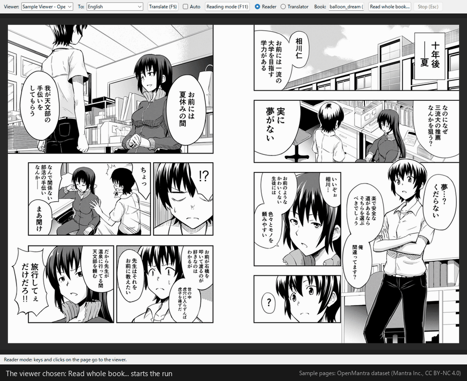

# TASlation

日本語: [README.ja.md](README.ja.md)

This is a translation. The Japanese text, [README.ja.md](README.ja.md), is the original, and it prevails where the two differ.

**A tool for reading your own manga on your own computer, translating as you read**

The TASlation (Tool Assisting Self-translation) window reads the manga page your viewer is showing,
translates it on this computer, and shows the translation laid over the page. It sends no image data and no translations outside. It is a tool that assists a lawful act: translating, to read it, a document you bought for yourself.

## See it working

This is the real window during "Translating the whole book" (reading is shown at 1.2x speed, translation at 1.5x). Nothing is staged: the real OCR and the real translation model are running.

1. **It reads as you turn the pages**: when you turn a page in the viewer, TASlation reads that page. The blue outlines are the lines it found. The pages it has read line up in the strip below.
2. **Press "Finished reading"**: press it when you have turned to the end. The viewer is not used from here on.
3. **The translation comes in line by line**: the page being translated is shown, and the Japanese in each bubble gives way to the translation as the model answers that line. Lines not translated yet stay as in the original, with an outline.
4. **Done**: when you open that page in the viewer, the translation is shown laid over it.

In this recording, translating 4 two-page screens (8 pages, 85 lines) took about 30 seconds on a computer with a GPU.

The pages in the recording are from the [OpenMantra dataset](https://github.com/mantra-inc/open-mantra-dataset) (published by Mantra Inc.; Hinami, Ishiwatari, Yasuda, Matsui, "Towards Fully Automated Manga Translation", AAAI 2021): the title バルーンドリーム by Mitsuki Kuchitaka (朽鷹みつき). The dataset is provided under [CC BY-NC 4.0](https://creativecommons.org/licenses/by-nc/4.0/) (attribution, non-commercial). In the recording TASlation has erased the Japanese and set an English translation in its place (the pages are changed). The recording is not covered by TASlation's own MIT licence, and it is not in the ZIP that is distributed.

## Why it was made

TASlation is a tool for people who buy manga legitimately and want to read it properly. It reads the Japanese in the speech bubbles of the page the viewer shows,
translates it on your own computer, redraws the bubbles with the translation and shows them on the screen. It does not upload, copy or share anything.
The translations stay on your computer, and there is no feature to save, export or distribute pages.

It is made, on purpose, so that it cannot become a way to read a book without the viewer. It saves only the translations, and even those are tied to a fingerprint of each page (the page fingerprint),
so they are of no use unless the real page is on the screen.

Buy the book from a store that sells the Japanese edition, open it in that store's viewer, and read it in your own language. The publisher and the author are paid, and you can read the same thing as readers in Japan, at the same price and at the same time.

## What it does

* On Windows, it captures the window of a viewer (a desktop viewer, a viewer you read in a browser, or a plain image viewer).
* It finds the lettering in speech bubbles and boxes, reads the Japanese with three OCR models (one that finds each character, and two that read the lines), and has a local AI model translate it. It erases the Japanese it recognised, sets the translation along the shape of the same bubble, as large as it fits, and shows it in the TASlation window.
* **Translation tools**: you can add and adjust the areas the OCR recognises afterwards. Bold, italic and fonts can be set. You can also add translator's notes. There is a dictionary of names and proper nouns, which is passed to the local AI for a more accurate translation.
* **Translating the whole book** (optional; the default is one page at a time): while you turn the pages and read on, it reads each page you turn. When you press "Finished reading", it translates them all together, with the whole story in view. TASlation never turns a page itself (so as not to break the terms of stores that offer services such as unlimited reading). You can read the translated pages only once the translation is finished. This suits in particular a computer with only a CPU, where translation takes time.
* **Reading mode** (F11): shows the translated pages full screen, so that you can read them as you would the original.
* **Over a full-screen viewer** (optional): when you put the viewer into full screen yourself, TASlation stays in front, like the on-screen keyboard, without taking key presses away from the viewer. You turn the pages in the viewer as usual (you can turn this off in the "View" menu). TASlation never puts the viewer into full screen, and never sends a key you did not press.
* **Many languages**: the interface is in 17 languages, and it translates into 20 languages (these have not been tested).

## What it does not do

| What it does not do | Details |
|---|---|
| Sending anything over the network | It never sends information outside to translate. Everything is done locally. |
| Saving page images | Captured pages, cut-out images and translated pages exist only in memory. There is no "Save image" button and no export command. The page images kept in memory while a whole book is translated are used only to show the page being worked on, as its progress, and to show a page you open in the viewer sooner. |
| Saving the Japanese original | The cache holds the *translations*, the positions of the bubbles and a 320-bit page fingerprint. The Japanese text is never written to disk. The cache, series-sheet and notes files are saved protected with Windows' own data protection (DPAPI), and only your Windows user on this computer can open them. The window's settings files (ui.json and the like) keep the names of the books you read last, unprotected. |
| Making the book readable without the viewer | What the cache holds can be shown only over the real page shown in the viewer, and only when the fingerprints match. The same goes for a whole book translated at once: the pages in memory cannot be paged through and read inside TASlation. Clicking a thumbnail in the page strip below only tells you to open that page in the viewer. It does not let you read without the viewer, because that causes problems, for example where payment depends on what is viewed. |
| Breaking the viewer's capture protection | It uses only Windows' ordinary window capture. A window the viewer has made uncapturable shows up black, and TASlation leaves it so. It decrypts nothing, and never touches DRM, file formats or network protocols. |
| Sharing | There is no account, no sync and no upload, and nothing is exported in a readable form. The saved files cannot be read when copied to another computer or opened by another Windows user. But a program running as your Windows user can open them, as TASlation does. You can turn your own translation cache into a file encrypted with your own passphrase, as a backup for yourself or for another computer of your own (or for a smartphone version of the reader that may be made in the future), but it cannot be read without the passphrase. Never share it. This file is the only way to keep a spare or to move the translations. After Windows is reinstalled, or an administrator resets your Windows password, the saved files can no longer be opened. |

## Legal position

TASlation is a tool for reading a book you have on your own screen. This section explains what it does in legal terms, where that is allowed,
why some features are left out on purpose, and what the notice at start is for. It explains things as far as the author understands them,
and it is not legal advice. Laws differ from country to country, and they change.

### What it does, in legal terms

Each time you turn a page, TASlation makes a temporary copy of what the viewer drew on the screen (a capture in memory),
translates the text with a model on your own computer (an adaptation of the work), and shows the result over the same page, to you alone. So that it does not translate a page twice,
it saves the translations, the positions of the bubbles and the page fingerprint in the cache. It keeps nothing else, and lets nothing out of your computer.

The capture is temporary. In Japan, since Article 2 requires a tangible reproduction, it may be considered not to be a reproduction at all,
and in any case it is within the reproduction incidental to computer processing that Article 47-4 allows. In the EU and the UK,
it is a temporary copy of the kind the mandatory exception for temporary copies covers. So what the law needs to accept is not the capture but the act of translating.

### Where it is allowed

What applies is the law of the place where you read, whatever the country of the book, the store or the publisher. Copyright is territorial: if a Japanese publisher sued a reader abroad,
it would sue under that country's law. Even in a country that regards a translation for your own use as an infringement, it is a civil matter. In theory the author could sue, but it is not a crime, and so far no one has been sued over a private translation that was not shared.
In any case, no means exists to detect a private translation.

Sharing a translation is another matter, and this is where the law is actually enforced. A translation alone can be a problem.
In July 2016, the Kyoto Prefectural Police arrested a man from Tokyo on suspicion of copyright infringement for translating the English subtitles of the film "Poltergeist" into Japanese
and publishing the subtitle file on a subtitle site. What the man distributed was not the film but only the translated dialogue.
In April 2017, the Amsterdam District Court, in a suit that a fan-subtitling group had itself brought against the copyright protection organisation BREIN,
ruled that making and distributing subtitles requires the rights holder's permission. In September 2017, a Swedish court convicted the founder of the subtitle site
Undertexter.se of copyright infringement, and the appeal was also rejected in 2018.

Giving someone a translation of a manga is the same act. In Japan it infringes the right of translation and the right of public transmission; it is a crime prosecuted on the rights holder's complaint,
in violation of Article 119 of the Copyright Act. That is why TASlation keeps translations on your screen and in a cache that only you can read.

Up to here, this has been about the law.
What follows is about you and each e-book store.

* **E-book stores' terms of use**: the terms of use of the large e-book stores are a contract between the reader and the store. Some of them forbid,
  even for private use, copying or translating the content, or limit its use to the store's own software. Breaking the terms is not a crime,
  but your account may be suspended and you may lose your library of purchased books.
* **You are the one who turns the pages**: TASlation does not turn pages itself. Even when translating the whole book, it reads only the pages you turned;
  the premise is that you read on by yourself, just as readers in Japan do. That does not, however, settle that there is no problem under a store's terms.
  Terms differ from store to store, so check them yourself.
  
This is a matter separate from copyright law; under copyright law, private copying and translation are allowed (in Japan, Articles 30 and 47-6 below).

### Laws on content: the book is shown as it was published

Manga sold in Japan is published under Japanese law, and TASlation shows it as it is, without censoring or filtering it.
Something that can be sold lawfully in Japan can be illegal to possess, import or view in other countries, even as drawings and even if you only read it privately,
and in a few countries simple possession is a serious crime. The typical case is sexual drawings of characters who look like minors (sexual images of real children are a crime in every country, Japan included; where countries differ is how they treat drawings).

* The UK's Coroners and Justice Act 2009 (section 62) makes possessing a "prohibited image of a child" a crime,
  and the provision was created precisely to cover images that are not photographs.
* Canada's Criminal Code (section 163.1) covers any visual representation, and the Supreme Court held in R. v. Sharpe that "person" includes imaginary persons.
  In 2010, a traveller was charged at the Canadian border over manga on a laptop, and the charge was withdrawn only two years later.
* In Australia, McEwen v Simmons (Supreme Court of New South Wales, 2008) held
  that a cartoon character can be a "person" for the offences concerning child abuse material.
* In the United States, 18 U.S.C. § 1466A makes possessing obscene drawings of minors a federal crime. In 2009 a collector pleaded guilty,
  and dozens of Japanese manga volumes were confiscated.
* South Korea's youth protection law extends to depictions recognisable as minors, anime and manga included, and punishes possession and viewing.
* Germany's Criminal Code, § 184b, extends to depictions of "realistic" events, so clearly fictional drawings are generally outside it, but realistic ones are covered.

Border officers may also examine the devices travellers carry. TASlation keeps no copies, but the e-books you have and what you saved yourself are your own responsibility.
If you are not sure that a book is legal where you read it, do not read it with TASlation. Do not read it at all.

### Country by country

The second half of the notice at start is written for the country you chose, in the window's language. Below, its content is summed up in one line per country. "Civil" means
that it is an infringement in law, but there is no criminal penalty for private use that is not shared. None of this is legal advice.

| Country | Copying and translating for yourself | Drawn depictions and possession |
|---|---|---|
| Japan | Allowed: Copyright Act, Articles 30 and 47-6 | Obscenity offences are offences of distribution and sale; private possession is outside them. The Child Pornography Act covers real children only; drawings are outside it |
| United Kingdom | No private-copying exception since 2015. A translation for yourself is an infringement (civil) | Prohibited images of a child (Coroners and Justice Act 2009, section 62) include drawings. Up to 3 years |
| United States | No private-use exception. Fair use has not been decided. Screen capture under DMCA section 1201 is unsettled | 18 U.S.C. § 1466A: obscene drawings of minors. A manga collector pleaded guilty in 2009 |
| Canada | Section 29.22 covers copying only, not translation (civil) | Section 163.1 includes imaginary persons (R. v. Sharpe). In 2010 a traveller was charged at the border over manga |
| Australia | Section 43C covers only format-shifting a book. Translation is not covered (civil) | A cartoon character is a "person" too (McEwen v Simmons). Works refused classification cannot be imported |
| New Zealand | No general private-use exception (civil) | Objectionable publications include manga. Knowing possession: up to 10 years |
| Ireland | Only fair dealing for research or private study (civil) | The 1998 Act includes depicted persons where the predominant impression is that of a child. Up to 5 years |
| Germany | Private copying under § 53. Under § 23 an adaptation is free until it is published | § 184b covers realistic ("wirklichkeitsnah") depictions. Clearly fictional drawings are generally outside it |
| Austria | Private copying under § 42. Using an adaptation needs consent, making one does not | § 207a covers realistic depictions |
| Switzerland | Copyright Act, Article 19: any use in the private sphere, translation included | Criminal Code, Article 197: fictional sexual acts with minors are hard pornography. Possession for your own use is punishable too |
| France | Private copying under Article L122-5. Article L122-4 makes any translation without consent unlawful (civil) | Article 227-23 covers "representations", drawings included. Extended in 2013 to persons who look like minors |
| Belgium | Private copying within the family circle. Translation is unsettled | Article 417/13 covers minors or persons who look like minors, real or simulated. The police say manga can fall under it |
| Netherlands | Private copying under Article 16b. A translation counts as a reproduction (Article 13) | Virtual material only when realistic. Drawings are outside it unless they cannot be told from a real child |
| Spain | Private copying under Article 31.2. Translation (transformation) is outside the exception (civil) | Article 189, "realistic images". The prosecutors' circular 2/2015 excludes cartoons and manga |
| Mexico | One private copy under Article 148 IV. Translation is not covered (civil) | Article 202 is written on the premise of real persons |
| Argentina | No private-copying exception at all (civil) | Article 128 (2018) punishes simple possession of "representations". Disputed for drawings |
| Brazil | Article 46 II covers small excerpts only (civil) | ECA, Articles 241-B and 241-C. "Any other form of visual representation" is interpreted as including drawings |
| Portugal | Private copying under Article 75(2)(a). Translation is not covered (civil) | Article 176, "realistic representations". Stylised drawings are generally outside it |
| Italy | Article 71-sexies covers sound and video recordings only. Translation is not covered (civil) | Virtual images under Article 600-quater.1. The Court of Cassation widened its scope in 2025. A comics collector was prosecuted |
| Poland | Personal use under Article 23. Its scope is broad | Article 202 § 4b: generated or processed images of minors. Debated for drawings |
| Russia | Personal copying under Article 1273. Translation is not covered (civil) | Article 242.1 requires the purpose of distribution. Unsettled for drawings |
| Türkiye | Personal copying under FSEK Article 38. Translation is not covered (civil) | TCK Article 226(3) is interpreted as extending to drawn and animated depictions. 2 to 5 years |
| Indonesia | One personal copy under Article 46. Translation is not covered (civil) | The Pornography Law includes cartoons. Possession for your own use is excluded by the elucidation. Distribution is a crime |
| Vietnam | One copy for personal research or study under Article 25. Translation is not covered (civil) | Article 326 requires the purpose of dissemination. Keeping it is subject to administrative penalties |
| China | Personal study, research or appreciation under Article 24(1). Translation included | Criminal Law, Articles 363 to 367, punish sale and dissemination. Possession alone is not a crime |
| Taiwan | Non-profit personal or family use under Article 51. Translation for that use under Article 63 | Child and Youth Sexual Exploitation Prevention Act. Debated for drawings |
| Hong Kong | No private-copying exception. A translation is an adaptation (civil) | Cap. 579 covers depictions of persons depicted as under 16, drawings included. There is a defence of artistic merit |
| Singapore | Copyright Act 2021: fair use only | Child abuse material under Penal Code section 377BK includes drawn depictions. Up to 5 years. Obscene publications and films are also crimes |
| Philippines | One copy for research or private study under section 187 (civil) | RA 11930: "child" includes hand-drawn images. Possession is a crime |
| South Korea | Private copying under Article 30. Translation for that use under Article 36 | The youth protection law covers depictions clearly recognisable as minors, anime and manga included. Possession and viewing are crimes |

### The notice at start

For these reasons, the window shows a notice when it starts. First it asks which country you are in (it suggests one from Windows' region setting)
and the window's language (it suggests one from the country), and shows a general notice in that language. The notice covers what TASlation does;
that private use is allowed in Japan but not everywhere; that translations must never be shared; that the book is shown as it was published,
and that possessing it may be illegal depending on where you read; and that translations can be wrong. It also explains what "a civil matter" means, that the law that applies is the law of the place where you read,
and the real risks, largest first (laws on possessing certain content, a store suspending your account for breaking its terms, and copyright, which becomes an issue only if you share translations).

The part for the country you chose (the content of the table above) is shown right after the first paragraph, under a heading with the country's name, because that is the part that decides things for you.
For a country not in the list, a general warning is shown.

The notice is shown at every start until you tick "Do not show this again".

### Disclaimer and trademarks

TASlation's code is free software under the MIT licence, provided as is, without any warranty. However, the weights of the three OCR models needed to read pages (manga-ocr-charspot-small, manga-ocr-nar-small, manga-ocr-base-CPT-flex) are CC BY-NC-SA 4.0, so **use of TASlation is limited to non-commercial use**. To the extent the law allows, the author
is not liable for any damage or legal consequence arising from the use of this software, from the books read with it, or from the information on this page and in the notice (a summary of laws that can change, not legal advice). Whether to use it is for you to decide, where you are.
The notice at start says so too, and asks for your agreement before the window opens.

TASlation is not affiliated with, not endorsed by, and not connected with any e-book store, viewer or publisher.

### Sources

The sources for each country's laws and cases are in [docs/LEGAL_SOURCES.md](docs/LEGAL_SOURCES.md).

## Requirements

* Windows 10/11 (64-bit)
* About 7.5 GB of free disk space (about 9.0 GB when you translate into Portuguese (Brazil) or Turkish; of the translation models, PLaMo 3 Translate 2B takes about 1.8 GB (about 3.8 GB only while it is being imported), and Qwen3.5 4B, used for Portuguese (Brazil) and Turkish, about 3.3 GB; only one of the two is installed, whichever your target language needs).
  On a computer with an NVIDIA GPU, PyTorch's GPU build needs about 3.7 GB more (and, during the installation only, about 2.6 GB more again)
* 16 GB of RAM recommended (measured: TASlation itself used up to about 2.5 GB, and Ollama, which does the translating, up to about 2 GB with a GPU and about 4 GB without one. Those are the figures with Ollama's cache switched off, as the installer does. With the cache, Ollama used up to about 10 GB with a GPU and about 7.4 GB without. It has not been tried on a computer with 8 GB)
* An NVIDIA GPU (6 GB of memory) recommended. Measured: the translation model used about 1.9 GB and the model that erases lettering on the art about 0.5 GB, besides what Windows and your other programs use. A 4 GB GPU works too, but when less than about 3 GB of its memory is free, part of the translation model runs on the CPU and translation is about 1.5 times slower. It also runs without a GPU (translation is then about 4 times slower). AMD and Intel GPUs are not used (it runs on the CPU).
* A viewer that shows the book (an app or a browser)

| Step | With a GPU | Without a GPU |
|---|---|---|
| One screen showing one page (about 10 lines) | about 6 s (3 to 8) | about 23 s (12 to 30) |
| One screen showing two pages (about 16 lines) | about 9 s (6 to 14) | about 30 s (19 to 45) |
| The first page after starting | 4 to 5 s more (the translation model loads) | the same |
| Reading and translating a whole book (190 pages) | about 15 to 20 min | about 35 min to 1 h |

The computer used for the measurements has an Intel Core i7-9700F (8 cores), 48 GB of RAM and a GeForce GTX 1660 Ti (6 GB). They were made on sample manga pages shown on a 1920×1080 screen. The whole-book times are estimates, calculated from 100 pages actually measured with the GPU and 16 pages without. The time you take to turn the pages is not included. Pages with more lines take longer (translating one line takes about 0.4 s with the GPU and about 1.5 to 1.8 s without). Reading the pages (OCR) is done on the CPU, so a GPU does not make it faster (about 3 s for one two-page screen).

## Installation

1. On GitHub, download it with "Code" → "Download ZIP", and **extract all** of the ZIP. Do not move the folder after the installation.
2. Double-click `install.cmd`. If a warning appears, go on with "More info" → "Run anyway".
3. First it asks for the language to translate into (a number or the English name; Enter takes the language shown). This language decides the translation model.
   Next it asks, once only, for your agreement to the terms of use of the three OCR models (about 700 MB in all) (non-commercial only, CC BY-NC-SA 4.0). TASlation cannot read pages without these models,
   so if you do not agree, it does not install. If the target language is neither Portuguese (Brazil) nor Turkish, it also asks for your agreement to the licence (the PLaMo Community License) of the translation model PLaMo 3 Translate 2B (about 1.8 GB) (those two languages use Qwen3.5 4B, about 3.3 GB, whose licence needs no agreement).
   The main points of PLaMo's licence (as revised on November 9, 2026): free for non-commercial use with no registration, 18 or older or a guardian's consent, the rights needed for what goes in and what comes out are yours to secure, and what you must say when you give a translation to someone or make it public (`docs/THIRD_PARTY.md`; TASlation asks you not to publish translations). If you answer the remaining questions with Enter, this computer gets everything it needs.
   If you answer Y to the questions whether to install Python and Ollama, you also agree to the terms of use shown by winget (Windows' package manager), which installs them (so that winget does not ask you partway through).
   It also asks whether to install the two models that find and erase lettering on the drawing (a layout model, about 170 MB, and an inpainting model, LaMa, about 200 MB).
   Neither of them makes clear where its training images come from, so it tells you that before it asks. On a computer with an NVIDIA GPU, Enter installs them ([Y/n]; TASlation uses LaMa on the GPU by default),
   and on a computer without a GPU, Enter does not ([y/N]; on such a computer they are models not used by default). A run without a console, and `-Yes`, do not install them on either kind of computer.
   The questions are shown in Japanese if Windows' display language is Japanese, and in English otherwise.
4. Start it from "TASlation" in the Start menu.

PyTorch (the component TASlation uses for the OCR and LaMa) is installed as the GPU build (the CUDA build; a download of about 2.6 GB, or about 2.0 GB for the newest GPUs such as the RTX 50 series) on a computer with an NVIDIA GPU,
and as the CPU build (about 0.13 GB) on a computer without one. Whether there is a GPU is found out only by asking `nvidia-smi`, which comes with NVIDIA's driver (no network is used), and you are asked nothing about it.
The sizes of the downloads are shown during the questions, before any download starts. The GPU build needs NVIDIA driver 528.33 or later (580 or later for the RTX 50 series and the like);
with an older driver, it says so and installs the CPU build (update the driver and run install.cmd again to get the GPU build). After installing the GPU build, it checks it by computing once on the GPU,
and if the download failed or it did not run on the GPU, it says so in one line, installs the CPU build and goes on with the installation. AMD and Intel GPUs are not counted as GPUs.
A GPU build already installed is left as it is. On a computer where a version before this one installed the CPU build, running install.cmd again replaces it with the GPU build (`update.cmd` does not replace it).

It makes two settings for Ollama without asking. Each is made only when its environment variable is not set yet, neither for this Windows user nor in the window running the installation,
and Ollama is restarted once afterwards. A value that is already there is left as it is. Only when the restarted server answers does it say "ok"; otherwise it warns
and tells you to start Ollama from the Start menu or restart the PC (the settings are saved and apply from its next start). When Ollama's app does not bring the server up,
it starts `ollama serve` in a hidden window instead, and says which way it started.

* On every computer with Ollama, it sets the environment variable `LLAMA_ARG_CACHE_RAM=0` for this Windows user. Without it, Ollama uses up to 8 GB of RAM
  for a cache of earlier requests. In TASlation's measurements that cache made translation faster only without a GPU, by about 8 %
  (while Ollama then used about 3.3 GB more RAM). The setting applies to the Ollama this user runs, and to any other
  program of this user that reads llama.cpp's `LLAMA_ARG_*` environment variables.
* If the NVIDIA GPU has 6 GB of memory or less, it also sets `OLLAMA_KV_CACHE_TYPE=q8_0`. Ollama then uses less GPU memory, so the translation model fits on the GPU more easily.

`uninstall.cmd` removes each of them if it still has the value the installer set. To undo one by hand, search the Start menu for "environment variables",
open "Edit environment variables for your account", delete the variable and restart Ollama.

When something could not be done, the installer keeps what it did, goes on to the end and lists the warnings there. Its last line then says
that TASlation cannot translate yet, and what to do. When the publisher's server refused a download or no longer has the file
(HTTP 401, 403, 404, 410), running it again will not help, so it tells you to update TASlation (download its newest copy and run `update.cmd`)
or to see the project's issues page.

The network is used only during the installation. Python, Ollama and the translation model are downloaded, with your agreement, if they are missing.
After that, TASlation does not connect to anything outside this computer.

All the questions come first. Once you have answered them, you can leave the computer. Depending on your connection, it takes about 15 to 60 minutes.
Download progress is shown in percent and MB. If the connection breaks partway, it goes on from where it broke off.

`install.cmd -Yes`, for runs nobody watches, never agrees to a licence by itself. Agreeing beforehand is only for automated checks of the installation: someone who has read both licences sets `TASLATION_AGREE_OCR_LICENCE` and `TASLATION_AGREE_PLAMO_LICENCE` to the exact sentences in install.ps1's help, and setting them is that person's agreement (to install TASlation for yourself, answer the questions).

### Updating

1. Download the new ZIP ("Code" → "Download ZIP" on GitHub) and close TASlation.
2. Double-click `update.cmd` in the TASlation folder.
3. When it asks where the new ZIP is, drag the ZIP file (or the extracted folder) onto the window and press Enter.
   If it is the newest `taslation*.zip` in your "Downloads" folder, Enter alone chooses it.
4. It shows the current version and the new version (with their dates) and asks once to confirm. Then it copies the new files and goes on with the same installation as `install.cmd`
   (if the new version needs anything more, it asks before downloading).

The installation after an update uses the PyTorch already installed, as it is. When the CPU build is installed although there is an NVIDIA GPU (installed by a version before this one),
it does not start a download of about 2.6 GB without asking; it says so instead. To get the GPU build, run `install.cmd`.
The installation after an update also makes the Ollama settings above (so a computer installed with a version before this one gets `LLAMA_ARG_CACHE_RAM` too).

`taslation.toml`, `.venv`, `models` and the data folder (`~/.taslation`) stay as they are. The program folder `taslation\` gets the same contents as the new version
(files that are not in the new version are deleted); no other file is deleted. `update.cmd` itself uses no network and reads only the ZIP or folder you give it.
You can also check the current version and its date under Help → "About TASlation".

To copy by hand, close TASlation, copy the **contents** of the `taslation-main` folder in the ZIP into the folder that holds `install.cmd`
(do not copy the folder itself; when asked, choose "Replace"), and run `install.cmd`.

### Uninstalling

Double-click `uninstall.cmd`: it shows a list of what will be removed and asks you to confirm (the default is "No"). It also asks, then and there, whether to delete data such as the translation cache (the default is to keep it).
It removes the Ollama environment variables the installer set (`LLAMA_ARG_CACHE_RAM`, `OLLAMA_KV_CACHE_TYPE`) if they still have that value. A value you have set again yourself stays. An Ollama that is running keeps the old settings until it restarts. Finally, delete the folder.

## How to use

1. Open the book in the viewer.
2. Start TASlation from "TASlation" in the Start menu, and choose the viewer's window in the "Viewer" list (once you have chosen it, it is chosen automatically from then on).
3. In the TASlation window, press a page key or click the page to turn it, and the translated page is shown (to read it large: reading mode, F11).

How to operate it is explained in the app, under "Help > How to use...". The settings you change often, such as the lettering size (80 to 130 %, which can also be set per book) and the size of the window's text, and the window's keys (shortcuts), can be changed in "Tools > Settings...". Whether each stage runs on the GPU or the CPU, and how many seconds a page took, can be checked on the "System" page of the same dialog and with `taslation doctor`.
Settings, the command line and the rest are described in detail in [docs/MANUAL.md](docs/MANUAL.md).

## Limitations

* Windows only.
* Reading and translating are automatic, so there are mistakes. Hand-drawn sound effects are left as drawn.
* When you switch between single-page and two-page display, the same page is treated as a different page.

More in [docs/MANUAL.md](docs/MANUAL.md).

## Third-party notices

All the projects used or referred to, and their licences, are listed in `docs/THIRD_PARTY.md`.
TASlation's code is under the MIT licence (see `LICENSE`). The weights of the three OCR models are CC BY-NC-SA 4.0; each user agrees to their terms and obtains them at installation (see `docs/THIRD_PARTY.md`).

Built with PLaMo: translation uses Preferred Networks' PLaMo 3 Translate 2B (PLaMo Community License, as revised on November 9, 2026). Portuguese (Brazil) and Turkish use Qwen3.5 4B (Apache-2.0).
